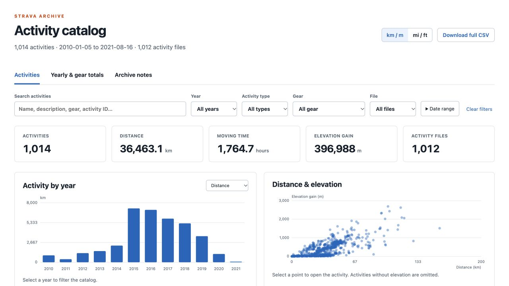
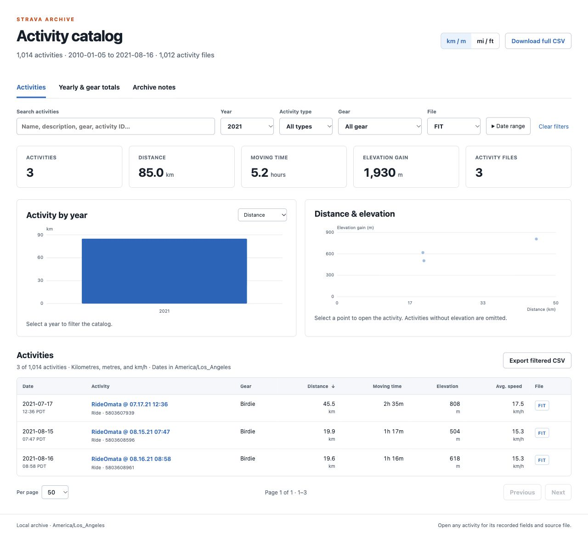
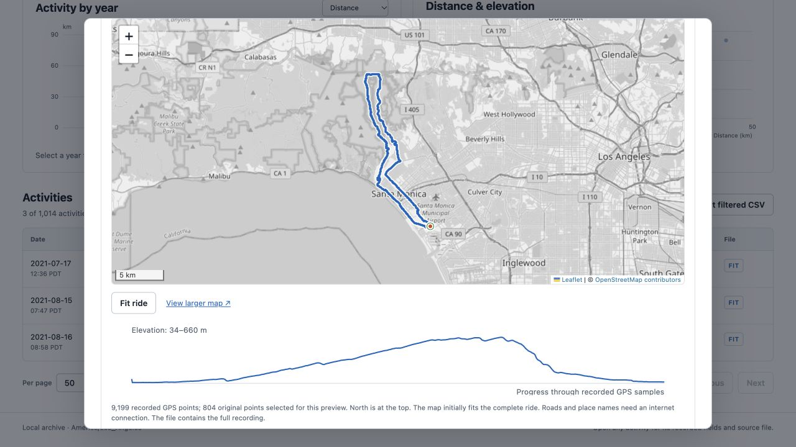
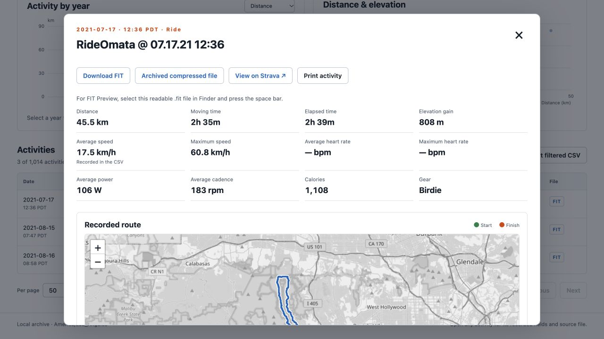

# Strava archive browser

Browse your Strava activity history on your own computer. Search and sort activities, compare yearly and gear totals, inspect recorded routes, and save individual FIT, GPX, or TCX files. Take a FIT file from your archive to [OVERLAND TRACES](https://overlandtraces.com/) to make a map video.



The screenshots use the author's own Strava archive. The personal archive and generated catalog are excluded from Git; use your own export when setting up this repository. This browser reads the activity records and recordings in an archive, rather than Strava's photos, comments, or other account files. It does not connect to or synchronize your Strava account.

## 1. Download your Strava archive

Request a bulk account export on the Strava website:

1. Sign in at [strava.com](https://www.strava.com/).
2. Open **Settings → My Account**.
3. Under **Download your account**, select **Get Started**.
4. Select **Request download** on the next page.
5. Wait for Strava's email, then use its link to download the ZIP to your computer. It may take a few hours; you need access to the email address on your account.

These steps follow [Strava's export instructions](https://support.strava.com/en-us/articles/15401919-how-do-i-export-my-strava-data). Keep the downloaded ZIP intact. This project's importer reads it directly, so you do not need to unzip it. The ZIP must contain `activities.csv` at its root and the recording files referenced by that CSV under `activities/`.

The archive preserves the formats of your original recordings. Some activities will have FIT files; others may have GPX or TCX files, and manual entries may have no recording. Importing the archive does not convert GPX or TCX recordings to FIT.

## 2. Set up the browser with your archive

You need [Node.js](https://nodejs.org/) 18 or newer, npm, and Python 3.9 or newer, available as `python3`. Standard imports use the bundled JavaScript FIT reader and Python's XML readers. The optional Mac decoder described in [technical notes](docs/technical-notes.md#optional-mac-fit-decoder) is only needed for some older FIT previews.

Download or clone this repository. Open a terminal in its folder, then install the dependencies and create the private data folder:

```sh
npm ci
mkdir -p data
```

Copy your Strava ZIP directly into `data/`. Edit **`archive.config.json`**, setting `archive` to that ZIP's relative path. For example, if you named the file `my-strava-archive.zip`:

```json
{
  "archive": "data/my-strava-archive.zip",
  "catalog": "data/catalog",
  "timezone": "America/Los_Angeles",
  "fitPreviewRepository": "../nfl-fit-file-preview"
}
```

Use your ZIP's actual filename. You can set `timezone` to your own IANA timezone, such as `Europe/London` or `America/New_York`; it controls displayed dates and year/date filtering. Keep `catalog` as `data/catalog`, which the browser's download links and script paths expect. Leave `fitPreviewRepository` unchanged unless you are setting up the optional Mac decoder; the normal import does not require that repository.

Build and verify the catalog:

```sh
npm run build
npm run verify
```

The importer reports its progress and writes activity metadata, route previews, exact archived recordings, and decompressed copies into `data/catalog/`. It leaves the source ZIP intact. A route preview parsing issue is recorded in the catalog; the activity's full source file remains available.

Start the browser:

```sh
npm start
```

Open [http://127.0.0.1:8765/](http://127.0.0.1:8765/). Keep the terminal open while browsing; stop the server with **Control-C**. The server listens only on your computer. No Strava login or API credentials are required by this app.

If a catalog already exists on your computer, you can go straight to `npm start`. After changing the ZIP or timezone in `archive.config.json`, run the build and verification commands again, then reload the page. A successful rebuild replaces the previous catalog, so keep each original ZIP you want to retain.

## 3. Browse, filter, and sort your activities

The **Activities** tab starts with the newest activities first. Filters combine with each other, and the totals and charts follow your current selection.

| Control | What it does |
| --- | --- |
| **Search activities** | Searches names, descriptions, private notes, gear, and activity IDs. |
| **Year** | Shows activities from one year. Selecting a bar in the yearly chart also sets this filter. |
| **Activity type** | Limits the list to a recorded type, such as Ride. |
| **Gear** | Finds activities recorded against a particular bike or other gear. |
| **File** | Selects FIT, GPX, TCX, or activities with no file. |
| **Date range** | Reveals inclusive start and end dates in your configured timezone. |
| **Clear filters** | Removes the search and filter selections. |

Scroll down to the activity table. Click **Date**, **Activity**, **Gear**, **Distance**, **Moving time**, **Elevation**, or **Avg. speed** to sort. Click the same heading again to reverse the order; its arrow shows the current direction. Sorting applies to the entire filtered selection, including other pages. Use **Previous**, **Next**, and **Per page** to move through the results.

For example, select **File → FIT**, optionally choose a year, and click **Distance** to find your longest FIT recordings. This screenshot shows the three 2021 FIT recordings sorted from longest to shortest:



Use **km / m** or **mi / ft** to change display units. **Yearly & gear totals** summarizes the current selection; selecting a year or gear name in that view filters the activity list. **Export filtered CSV** saves the filtered activities in their current sort order. **Download full CSV** saves the complete normalized index. CSV exports contain activity metadata; download a recording separately for a route video.

## 4. Inspect a route and download its FIT file

Click an activity's name to open its details. You can inspect measurements, the recorded route, the elevation profile, descriptions, notes, and the original CSV fields. For a GPS recording, the map supports zooming and panning; **Fit ride** restores the complete route view.



To save a FIT recording:

1. Set **File → FIT** in the activity filters.
2. Click the **FIT** link in an activity's **File** column, or open its details and choose **Download FIT**.
3. Find the saved `.fit` file in your browser's download folder. Its filename comes from the archive and may be a number rather than the activity title.



Choose **Download FIT** for OVERLAND TRACES. If the archive entry was compressed as `.fit.gz`, the importer has already created a losslessly decompressed `.fit` copy. **Archived compressed file** saves the original `.fit.gz` entry. Both preserve the recording; the normal FIT download is ready to open in the studio. The route preview uses sampled points for display, while the downloaded file retains the complete recording.

GPX and TCX activities have download links for their own formats. **No file** means the archive has no recording for that activity. A missing or failed route preview does not by itself mean the source file is missing, but a recording without GPS coordinates cannot supply a route video.

## 5. Make a video with OVERLAND TRACES

[OVERLAND TRACES](https://overlandtraces.com/) accepts FIT and GPX recordings. Use the `.fit` file you just saved:

1. Open [overlandtraces.com](https://overlandtraces.com/) and sign in, or create an account through the site's sign-up flow.
2. In the [studio](https://overlandtraces.com/studio), select **Choose ride file** and choose your `.fit` download, or drop the file onto the opening screen. Select an individual recording, rather than the full Strava ZIP or a CSV export.
3. Inspect the imported route. Choose the map style, camera movement, units, track appearance, and playback pace.
4. Open **Video export**. Choose your layout and video length, review the preview and the account allowance shown there, then select **Render MP4** to submit the recording for processing.
5. Wait for processing to complete. Open **My videos** to download the finished MP4 and save it on your computer.

Opening a recording in the studio reads it on your device; requesting a video render saves the route to your private OVERLAND TRACES account. Maps and video processing require an internet connection.

A GPX recording with GPS data can follow the same workflow. TCX is not an accepted studio input. For a TCX-only activity, open **View on Strava**, then use the activity's ellipsis menu to select **Export GPX**, as described in [Strava's export instructions](https://support.strava.com/en-us/articles/15401919-how-do-i-export-my-strava-data). Renaming a `.tcx` file to `.fit` does not convert it.

## Troubleshooting

| What you see | What to check |
| --- | --- |
| `Archive not found` | Check the filename in `archive.config.json` and place the original ZIP directly under `data/`. |
| An import error mentioning `activities.csv` | Use the account archive with `activities.csv` at the ZIP root and its referenced recordings under `activities/`. A ZIP containing another enclosing folder needs its structure corrected first. |
| An empty or broken page on a fresh checkout | Run `npm ci`, `npm run build`, and `npm run verify`, then open the local server URL. The Git checkout contains no personal catalog. |
| `Address already in use` | Use the server already running at port 8765, or run `npm start -- --port 8766` and open `http://127.0.0.1:8766/`. |
| Too few activities or no matches | Select **Clear filters** and check the date range covered by the archive. Strava activity history added after the export needs a newer archive. |
| Roads or place names do not load | Map tiles need internet access. Local activity data, recorded route geometry, and elevation previews remain available. |
| No route preview | Inspect **Archive notes → Preview coverage**. Some recordings have no GPS data, and some older FIT files need the optional Mac decoder. The original file can still be downloaded. |
| OVERLAND TRACES will not open a recording | Check that you selected an uncompressed `.fit` or `.gpx` with recorded GPS coordinates. The account ZIP, CSV, TCX, and `.fit.gz` are different inputs. |

See [technical notes](docs/technical-notes.md) for file layout, the optional FIT decoder, source preservation, and verification details.
